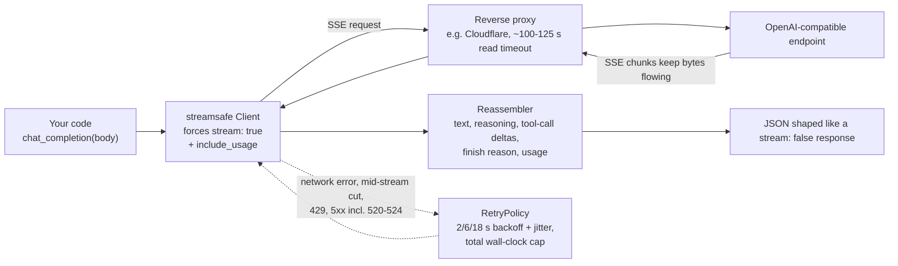

<h1 align="center">streamsafe</h1>

<p align="center">
  <strong>常にストリーミングする OpenAI 互換クライアント。長時間の推論呼び出しもプロキシのタイムアウトで途切れません。</strong>
</p>

<p align="center">
  <a href="https://github.com/sdpwh7-ux/streamsafe/actions/workflows/ci.yml"></a>
  <a href="LICENSE"></a>
  <a href="https://www.python.org/"></a>
  <a href="https://pypi.org/project/requests/"></a>
</p>

<p align="center">
  <a href="README.md">English</a> | <a href="README.zh-CN.md">简体中文</a> | <strong>日本語</strong>
</p>

---

## 🤔 なぜ必要か

多くの OpenAI 互換エンドポイント（セルフホストのゲートウェイ、リレー、one-api/new-api 系のプロキシ、企業の出口ゲートウェイ）は、読み取りタイムアウトが固定されたリバースプロキシの背後にあります。Cloudflare の背後ではこれがおよそ **100〜125 秒** で、それを過ぎるとクライアントは `error code: 524` を受け取ります。

そのため、3 分間考える推論モデルへの**非ストリーミング**呼び出しは、モデル自体は回答できたはずなのに失敗し、しかも**トークン料金はそのまま発生します**。

ストリーミングならデータが流れ続けるので、プロキシはタイムアウトしません。しかし多くのスクリプト（そしてエージェントが書くスクリプトの多く）は、シンプルな `stream: false` の JSON を求めています。**streamsafe はその両方を実現します。**

| | プロキシの読み取りタイムアウトに耐える | シンプルな `stream: false` JSON を返す |
| --- | :---: | :---: |
| 通常の非ストリーミング呼び出し | ❌ | ✅ |
| 自前のストリーミング処理 | ✅ | ❌ |
| **streamsafe** | ✅ | ✅ |

## ✨ 特長

- 🔁 **非ストリーミング呼び出しのドロップイン置き換え**：`chat_completion(body)` / `responses_create(body)` は内部で **`stream: true` を強制**し、ストリームを `stream: false` 呼び出しが返すのとまったく同じ JSON 形状に**再構成**します。
- 🧠 **完全な再構成**：テキスト、推論内容（reasoning content）、マージ済みのツール呼び出しデルタ、終了理由、使用量（`stream_options.include_usage` は自動設定）。
- 📡 **必要ならライブ出力も**：`chat_stream` / `responses_stream` は `(text, final_json, status)` を返し、ライブ出力用の `on_delta` コールバックも使えます。
- 🛡️ **保守的なリトライポリシー**：リトライするのはネットワークエラー、ストリーム途中の切断、429、5xx（520〜524 を含む）のみ。それ以外の 4xx は決してリトライしません。バックオフは 2/6/18 秒＋ジッターで、合計経過時間の上限内に収まります。
- 💸 **二重課金を防止**：有料ジョブ投入用の別ポリシー `NONIDEMPOTENT_RETRY` は 500/504/52x をリトライしません。
- 🚦 **同時実行制限に対応**："Too many concurrent requests" エラー（シングルシートのリレーアカウントでよく発生）は 429 として扱い、より長いバックオフを適用します。
- 🔐 **API キーを決して表示しない**：エラーテキストはマスクされ、`download()` は URL のホストが API ホストと一致する場合にのみキーを付与します。
- 📊 **使用量記録フック**：試行ごとに 1 回、エンドポイント・モデル・最終 JSON・ステータスを受け取るコールバック。
- 🖥️ **CLI**：`curl -d @body.json -o out.json` のストリーミング版ドロップイン置き換え。
- 🪶 **軽量**：小さなモジュール 1 つ、依存は `requests` のみ。

## ⚙️ 仕組み



1. `stream: false` で呼び出すときと同じ、通常のリクエストボディを渡します。
2. streamsafe は `stream: true` と `stream_options.include_usage` を付けて送信し、データがプロキシを流れ続けるようにします。
3. デルタを 1 つのレスポンスにまとめ直します：テキスト、推論内容、ツール呼び出し、終了理由、使用量。
4. 一時的な失敗はコストを意識した保守的なポリシーでリトライし、それ以外はすぐにエラーとして返します。

## 🚀 クイックスタート

### インストール

```bash
pip install git+https://github.com/sdpwh7-ux/streamsafe.git
# or just copy streamsafe/ into your project
```

### Python

```python
from streamsafe import Client

c = Client()  # reads STREAMSAFE_BASE_URL / STREAMSAFE_API_KEY (or OPENAI_BASE_URL / OPENAI_API_KEY)
d = c.chat_completion({"model": "my-reasoning-model",
                       "messages": [{"role": "user", "content": "Prove it step by step."}]})
print(d["choices"][0]["message"]["content"])
print(d["choices"][0]["message"].get("reasoning_content"))
print(d["usage"])

r = c.responses_create({"model": "my-model", "input": "hello", "tools": [{"type": "web_search"}]})

text, final, _ = c.chat_stream({"model": "m", "messages": [...]}, on_delta=lambda s: print(s, end=""))
```

### コマンドライン

`curl -d @body.json -o out.json` のストリーミング版ドロップイン置き換え：

```bash
python -m streamsafe chat examples/body.chat.json out.json        # or: streamsafe chat ...
python -m streamsafe responses body.json - --read-timeout 1200    # '-' = stdout
```

HTTP 風のステータス（`200` またはエラーステータス）を stderr に出力し、成功時は終了コード `0`、失敗時は `1` で終了します。

### 使用量記録フック

```python
def on_usage(endpoint, model, final_json, ok, status, error):
    ...  # e.g. append to a JSONL ledger; called once per attempt, exceptions are swallowed

c = Client(on_usage=on_usage)
```

## 🔧 設定

| 変数 | デフォルト | 意味 |
| --- | --- | --- |
| `STREAMSAFE_BASE_URL` / `OPENAI_BASE_URL` | `https://api.openai.com/v1` | API のベース URL（`/v1` を含める） |
| `STREAMSAFE_API_KEY` / `OPENAI_API_KEY` | - | API キー |
| `STREAMSAFE_KEY_FILE` | - | 代わりにこのファイルからキーを読み込む（推奨、`chmod 600`） |
| `STREAMSAFE_RETRY_MAX_ATTEMPTS` | `3` | 1 回の呼び出しあたりの試行回数 |
| `STREAMSAFE_RETRY_TOTAL_CAP` | `900` | リトライ全体の合計秒数 |
| `STREAMSAFE_CONCURRENCY_BACKOFF` | `20` | 同時実行制限エラー後の最小待機時間 |

これらはすべて `Client(...)` / `RetryPolicy(...)` に渡すこともできます。

## 🔒 セキュリティモデル

エージェント向けツールに安心して渡せるよう設計されています：

- 🔑 **認証情報。** キーをコマンドラインに書くより `STREAMSAFE_KEY_FILE` を推奨します。キーは設定したベース URL のホストにのみ送信され、エラーメッセージとリトライログはマスクされます。マスク対象は*この*キーのみなので、他の秘密情報をプロンプトに含めないでください。
- 🌐 **ネットワーク。** streamsafe が通信するのは設定したベース URL（および明示的に `download()` した URL）だけです。信頼できるエンドポイントにのみ向けてください。ゲートウェイはすべてのプロンプトとレスポンスを見ることができます。
- 💰 **リトライには費用がかかる。** リトライは新しい課金対象の呼び出しです。デフォルトのポリシーは、リクエストが何も生成しなかった可能性が高い失敗のみをリトライします。高価な、または副作用のあるリクエストには `NONIDEMPOTENT_RETRY`（または `RetryPolicy(max_attempts=1)`）を使ってください。
- 📁 **シェルや他のファイルへのアクセスなし。** CLI は指定されたボディファイルを読み、指定された出力ファイルに書き込むだけです。

## 🗺️ プロジェクトの状況とロードマップ

streamsafe は**オープンソース化されたばかり**です。小さく焦点を絞ったライブラリですが、まだ広く使われてはいないため、粗削りな部分や API の調整がありえます。

- [x] Chat Completions と Responses API：ストリーミング強制＋`stream: false` JSON への再構成
- [x] 保守的なデフォルトのリトライポリシーと `NONIDEMPOTENT_RETRY`
- [x] 同時実行制限への対応
- [x] CLI と使用量記録フック
- [x] ローカルの疑似 SSE サーバーを使ったオフラインテストスイート
- [ ] より多くの OpenAI 互換ゲートウェイ・リレーでの互換性レポート（協力募集中）

## 🤝 コントリビュート

Issue や Pull Request を歓迎します。特に、ゲートウェイによってストリームが正しく再構成されない場合のバグ報告は大歓迎です。ログを共有する前に API キーや非公開のプロンプトを削除してください。

提出前にテストスイートを実行してください：

```bash
python -m unittest discover -s tests -v   # runs against a local fake SSE server, no network
```

## 📄 ライセンス

[MIT](LICENSE)

---

## 🧰 エージェントツールキットの一部

| リポジトリ | |
| --- | --- |
| [taskwake](https://github.com/sdpwh7-ux/taskwake) | |
| [agent-search-kit](https://github.com/sdpwh7-ux/agent-search-kit) | |
| [**streamsafe**](https://github.com/sdpwh7-ux/streamsafe) | 📍 このリポジトリ |
| [agent-usage-ledger](https://github.com/sdpwh7-ux/agent-usage-ledger) | |
| [git-box-sync](https://github.com/sdpwh7-ux/git-box-sync) | |
