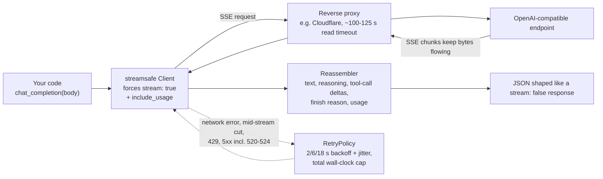

<h1 align="center">streamsafe</h1>

<p align="center">
  <strong>An OpenAI-compatible client that always streams, so long reasoning calls survive proxy timeouts.</strong>
</p>

<p align="center">
  <a href="https://github.com/sdpwh7-ux/streamsafe/actions/workflows/ci.yml"></a>
  <a href="LICENSE"></a>
  <a href="https://www.python.org/"></a>
  <a href="https://pypi.org/project/requests/"></a>
</p>

<p align="center">
  <strong>English</strong> | <a href="README.zh-CN.md">简体中文</a> | <a href="README.ja.md">日本語</a>
</p>

---

## 🤔 Why

Many OpenAI-compatible endpoints (self-hosted gateways, relays, one-api/new-api style proxies, corporate egress) sit behind a reverse proxy with a fixed read timeout. Behind Cloudflare that is roughly **100-125 seconds**, after which the client gets `error code: 524`.

A **non-streamed** call to a reasoning model that thinks for three minutes therefore fails even though the model would have answered, and **you pay for the tokens anyway**.

Streaming keeps bytes flowing, so the proxy never times out. But most scripts (and most agents writing scripts) want the simple `stream: false` JSON. **streamsafe gives you both.**

| | Survives proxy read timeout | Returns simple `stream: false` JSON |
| --- | :---: | :---: |
| Plain non-streamed call | ❌ | ✅ |
| Hand-rolled streaming | ✅ | ❌ |
| **streamsafe** | ✅ | ✅ |

## ✨ Features

- 🔁 **Drop-in non-streamed calls**: `chat_completion(body)` / `responses_create(body)` internally **force `stream: true`** and **reassemble the stream** into the exact JSON shape a `stream: false` call returns.
- 🧠 **Complete reassembly**: text, reasoning content, merged tool-call deltas, finish reason and usage (`stream_options.include_usage` is set automatically).
- 📡 **Live streaming when you want it**: `chat_stream` / `responses_stream` return `(text, final_json, status)` plus an `on_delta` callback for live output.
- 🛡️ **Conservative retry policy**: only network errors, mid-stream cuts, 429 and 5xx (incl. 520-524) are retried; other 4xx errors are never retried. Backoff is 2/6/18 s with jitter, under a total wall-clock cap.
- 💸 **No double charges**: a separate `NONIDEMPOTENT_RETRY` policy for paid job submissions does not retry 500/504/52x.
- 🚦 **Concurrency-limit aware**: "Too many concurrent requests" errors (common on single-seat relay accounts) are treated as 429 with a longer backoff.
- 🔐 **Key never printed**: error text is redacted, and `download()` only attaches the key when the URL's host is the API host.
- 📊 **Usage accounting hook**: get a callback once per attempt with endpoint, model, final JSON and status.
- 🖥️ **CLI**: a streaming drop-in for `curl -d @body.json -o out.json`.
- 🪶 **Tiny**: one small module; the only dependency is `requests`.

## ⚙️ How it works



1. You pass a normal request body, exactly as you would for a `stream: false` call.
2. streamsafe sends it with `stream: true` and `stream_options.include_usage`, so data keeps flowing through the proxy.
3. Deltas are merged back into a single response: text, reasoning content, tool calls, finish reason and usage.
4. Transient failures are retried under a conservative, cost-aware policy; everything else surfaces immediately.

## 🚀 Quick start

### Install

```bash
pip install git+https://github.com/sdpwh7-ux/streamsafe.git
# or just copy streamsafe/ into your project
```

### Python

```python
from streamsafe import Client

c = Client()  # reads STREAMSAFE_BASE_URL / STREAMSAFE_API_KEY (or OPENAI_BASE_URL / OPENAI_API_KEY)
d = c.chat_completion({"model": "my-reasoning-model",
                       "messages": [{"role": "user", "content": "Prove it step by step."}]})
print(d["choices"][0]["message"]["content"])
print(d["choices"][0]["message"].get("reasoning_content"))
print(d["usage"])

r = c.responses_create({"model": "my-model", "input": "hello", "tools": [{"type": "web_search"}]})

text, final, _ = c.chat_stream({"model": "m", "messages": [...]}, on_delta=lambda s: print(s, end=""))
```

### Command line

A streaming drop-in for `curl -d @body.json -o out.json`:

```bash
python -m streamsafe chat examples/body.chat.json out.json        # or: streamsafe chat ...
python -m streamsafe responses body.json - --read-timeout 1200    # '-' = stdout
```

It prints the HTTP-like status to stderr (`200` or the error status) and exits `0` on success, `1` on failure.

### Usage accounting hook

```python
def on_usage(endpoint, model, final_json, ok, status, error):
    ...  # e.g. append to a JSONL ledger; called once per attempt, exceptions are swallowed

c = Client(on_usage=on_usage)
```

## 🔧 Configuration

| Variable | Default | Meaning |
| --- | --- | --- |
| `STREAMSAFE_BASE_URL` / `OPENAI_BASE_URL` | `https://api.openai.com/v1` | API base URL (include `/v1`) |
| `STREAMSAFE_API_KEY` / `OPENAI_API_KEY` | - | API key |
| `STREAMSAFE_KEY_FILE` | - | read the key from this file instead (recommended, `chmod 600`) |
| `STREAMSAFE_RETRY_MAX_ATTEMPTS` | `3` | attempts per call |
| `STREAMSAFE_RETRY_TOTAL_CAP` | `900` | total seconds across retries |
| `STREAMSAFE_CONCURRENCY_BACKOFF` | `20` | minimum wait after a concurrency-limit error |

All of these can also be passed to `Client(...)` / `RetryPolicy(...)`.

## 🔒 Security model

Designed to be safe to hand to agent tooling:

- 🔑 **Credentials.** Prefer `STREAMSAFE_KEY_FILE` over putting the key on a command line. The key is only sent to the configured base URL's host; error messages and retry logs are redacted. Redaction only covers *this* key, so do not pass other secrets in prompts.
- 🌐 **Network.** streamsafe only talks to the base URL you configure (plus any URL you explicitly `download()`). Point it only at endpoints you trust: the gateway sees every prompt and response.
- 💰 **Retries cost money.** A retried call is a new, billable call. The default policy only retries failures where the request most likely produced nothing; use `NONIDEMPOTENT_RETRY` (or `RetryPolicy(max_attempts=1)`) for expensive or side-effecting requests.
- 📁 **No shell or file access.** The CLI only reads the body file you give it and writes the output file you name.

## 🗺️ Project status & roadmap

streamsafe is **newly open-sourced**. It is small and focused, but it has not yet seen wide use, so expect rough edges and possible API adjustments.

- [x] Chat Completions and Responses API: forced streaming + reassembly into `stream: false` JSON
- [x] Conservative default retry policy and `NONIDEMPOTENT_RETRY`
- [x] Concurrency-limit handling
- [x] CLI and usage accounting hook
- [x] Offline test suite against a local fake SSE server
- [ ] Compatibility reports from more OpenAI-compatible gateways and relays (help wanted)

## 🤝 Contributing

Issues and pull requests are welcome, especially bug reports with streams from gateways that reassemble incorrectly. Please remove API keys and private prompts before sharing logs.

Run the test suite before submitting:

```bash
python -m unittest discover -s tests -v   # runs against a local fake SSE server, no network
```

## 📄 License

[MIT](LICENSE)

---

## 🧰 Part of the agent toolkit

| Repo | |
| --- | --- |
| [taskwake](https://github.com/sdpwh7-ux/taskwake) | |
| [agent-search-kit](https://github.com/sdpwh7-ux/agent-search-kit) | |
| [**streamsafe**](https://github.com/sdpwh7-ux/streamsafe) | 📍 you are here |
| [agent-usage-ledger](https://github.com/sdpwh7-ux/agent-usage-ledger) | |
| [git-box-sync](https://github.com/sdpwh7-ux/git-box-sync) | |
