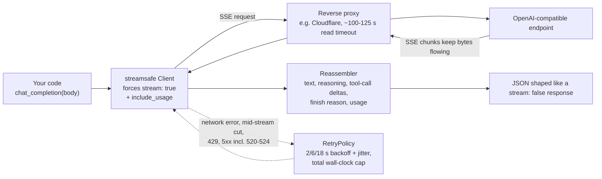

<h1 align="center">streamsafe</h1>

<p align="center">
  <strong>一个始终使用流式传输的 OpenAI 兼容客户端，让长时间推理调用不再被代理超时中断。</strong>
</p>

<p align="center">
  <a href="https://github.com/sdpwh7-ux/streamsafe/actions/workflows/ci.yml"></a>
  <a href="LICENSE"></a>
  <a href="https://www.python.org/"></a>
  <a href="https://pypi.org/project/requests/"></a>
</p>

<p align="center">
  <a href="README.md">English</a> | <strong>简体中文</strong> | <a href="README.ja.md">日本語</a>
</p>

---

## 🤔 为什么需要它

许多 OpenAI 兼容端点（自建网关、中转服务、one-api/new-api 类代理、企业出口网关）都部署在读取超时固定的反向代理之后。在 Cloudflare 后面，这个超时大约是 **100-125 秒**，超时后客户端会收到 `error code: 524`。

因此，对一个需要思考三分钟的推理模型发起**非流式**调用时，即使模型本可以给出答案，请求也会失败，而且**token 费用照样产生**。

流式传输能让数据持续流动，代理就不会超时。但大多数脚本（以及大多数由智能体编写的脚本）想要的是简单的 `stream: false` JSON。**streamsafe 两者兼得。**

| | 不受代理读取超时影响 | 返回简单的 `stream: false` JSON |
| --- | :---: | :---: |
| 普通非流式调用 | ❌ | ✅ |
| 手写流式处理 | ✅ | ❌ |
| **streamsafe** | ✅ | ✅ |

## ✨ 功能特性

- 🔁 **非流式调用的直接替代**：`chat_completion(body)` / `responses_create(body)` 在内部**强制 `stream: true`**，并把流**重新组装**成与 `stream: false` 调用完全相同的 JSON 结构。
- 🧠 **完整组装**：文本、推理内容（reasoning content）、合并后的工具调用增量、结束原因和用量（自动设置 `stream_options.include_usage`）。
- 📡 **需要时可实时流式输出**：`chat_stream` / `responses_stream` 返回 `(text, final_json, status)`，并提供 `on_delta` 回调用于实时输出。
- 🛡️ **保守的重试策略**：只重试网络错误、流中途断开、429 和 5xx（含 520-524）；其他 4xx 错误从不重试。退避间隔为 2/6/18 秒并带随机抖动，且受总耗时上限约束。
- 💸 **避免重复计费**：为付费任务提交单独提供 `NONIDEMPOTENT_RETRY` 策略，不重试 500/504/52x。
- 🚦 **感知并发限制**："Too many concurrent requests" 错误（在单席位中转账号上很常见）被视为 429，并使用更长的退避时间。
- 🔐 **从不打印密钥**：错误文本会被脱敏；`download()` 只有在 URL 的主机与 API 主机相同时才附带密钥。
- 📊 **用量记账钩子**：每次尝试都会回调一次，提供端点、模型、最终 JSON 和状态。
- 🖥️ **命令行工具**：可流式替代 `curl -d @body.json -o out.json`。
- 🪶 **轻量**：单个小模块，唯一依赖是 `requests`。

## ⚙️ 工作原理



1. 你像发起 `stream: false` 调用一样传入普通的请求体。
2. streamsafe 以 `stream: true` 和 `stream_options.include_usage` 发送请求，让数据持续穿过代理。
3. 增量被合并回单个响应：文本、推理内容、工具调用、结束原因和用量。
4. 临时性故障按保守且考虑成本的策略重试；其他错误立即抛出。

## 🚀 快速开始

### 安装

```bash
pip install git+https://github.com/sdpwh7-ux/streamsafe.git
# or just copy streamsafe/ into your project
```

### Python

```python
from streamsafe import Client

c = Client()  # reads STREAMSAFE_BASE_URL / STREAMSAFE_API_KEY (or OPENAI_BASE_URL / OPENAI_API_KEY)
d = c.chat_completion({"model": "my-reasoning-model",
                       "messages": [{"role": "user", "content": "Prove it step by step."}]})
print(d["choices"][0]["message"]["content"])
print(d["choices"][0]["message"].get("reasoning_content"))
print(d["usage"])

r = c.responses_create({"model": "my-model", "input": "hello", "tools": [{"type": "web_search"}]})

text, final, _ = c.chat_stream({"model": "m", "messages": [...]}, on_delta=lambda s: print(s, end=""))
```

### 命令行

可流式替代 `curl -d @body.json -o out.json`：

```bash
python -m streamsafe chat examples/body.chat.json out.json        # or: streamsafe chat ...
python -m streamsafe responses body.json - --read-timeout 1200    # '-' = stdout
```

它会把类似 HTTP 的状态码输出到 stderr（`200` 或错误状态码），成功时退出码为 `0`，失败时为 `1`。

### 用量记账钩子

```python
def on_usage(endpoint, model, final_json, ok, status, error):
    ...  # e.g. append to a JSONL ledger; called once per attempt, exceptions are swallowed

c = Client(on_usage=on_usage)
```

## 🔧 配置

| 变量 | 默认值 | 含义 |
| --- | --- | --- |
| `STREAMSAFE_BASE_URL` / `OPENAI_BASE_URL` | `https://api.openai.com/v1` | API 基础 URL（需包含 `/v1`） |
| `STREAMSAFE_API_KEY` / `OPENAI_API_KEY` | - | API 密钥 |
| `STREAMSAFE_KEY_FILE` | - | 改为从该文件读取密钥（推荐，`chmod 600`） |
| `STREAMSAFE_RETRY_MAX_ATTEMPTS` | `3` | 每次调用的尝试次数 |
| `STREAMSAFE_RETRY_TOTAL_CAP` | `900` | 所有重试累计的总秒数 |
| `STREAMSAFE_CONCURRENCY_BACKOFF` | `20` | 遇到并发限制错误后的最短等待时间 |

以上所有配置也都可以传给 `Client(...)` / `RetryPolicy(...)`。

## 🔒 安全模型

专为可以放心交给智能体工具使用而设计：

- 🔑 **凭据。** 优先使用 `STREAMSAFE_KEY_FILE`，不要把密钥写在命令行上。密钥只会发送到所配置的基础 URL 的主机；错误信息和重试日志都会脱敏。脱敏只覆盖*这一个*密钥，因此不要在提示词中传入其他机密信息。
- 🌐 **网络。** streamsafe 只与你配置的基础 URL 通信（以及你显式调用 `download()` 的 URL）。只把它指向你信任的端点：网关能看到每一条提示词和响应。
- 💰 **重试会产生费用。** 每次重试都是一次新的、计费的调用。默认策略只重试那些请求很可能没有产生任何结果的失败；对于昂贵或有副作用的请求，请使用 `NONIDEMPOTENT_RETRY`（或 `RetryPolicy(max_attempts=1)`）。
- 📁 **不访问 shell 或其他文件。** 命令行工具只读取你指定的请求体文件，并写入你指定的输出文件。

## 🗺️ 项目状态与路线图

streamsafe **刚刚开源**。它小巧专注，但尚未经过广泛使用，可能存在不完善之处，API 也可能调整。

- [x] Chat Completions 与 Responses API：强制流式 + 组装为 `stream: false` JSON
- [x] 保守的默认重试策略与 `NONIDEMPOTENT_RETRY`
- [x] 并发限制处理
- [x] 命令行工具与用量记账钩子
- [x] 基于本地模拟 SSE 服务器的离线测试套件
- [ ] 收集更多 OpenAI 兼容网关和中转服务的兼容性反馈（欢迎帮助）

## 🤝 参与贡献

欢迎提交 Issue 和 Pull Request，尤其欢迎报告某些网关的流被错误组装的问题。分享日志前请移除 API 密钥和私密提示词。

提交前请运行测试套件：

```bash
python -m unittest discover -s tests -v   # runs against a local fake SSE server, no network
```

## 📄 许可证

[MIT](LICENSE)

---

## 🧰 智能体工具集的一部分

| 仓库 | |
| --- | --- |
| [taskwake](https://github.com/sdpwh7-ux/taskwake) | |
| [agent-search-kit](https://github.com/sdpwh7-ux/agent-search-kit) | |
| [**streamsafe**](https://github.com/sdpwh7-ux/streamsafe) | 📍 当前仓库 |
| [agent-usage-ledger](https://github.com/sdpwh7-ux/agent-usage-ledger) | |
| [git-box-sync](https://github.com/sdpwh7-ux/git-box-sync) | |
